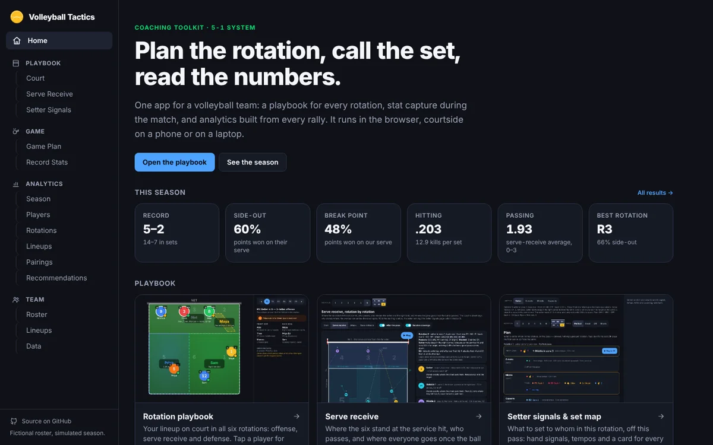
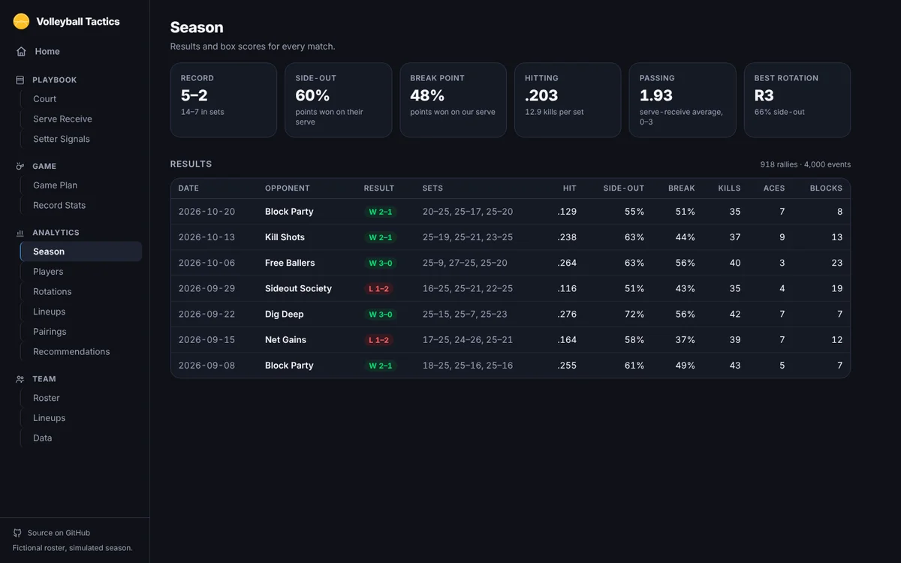
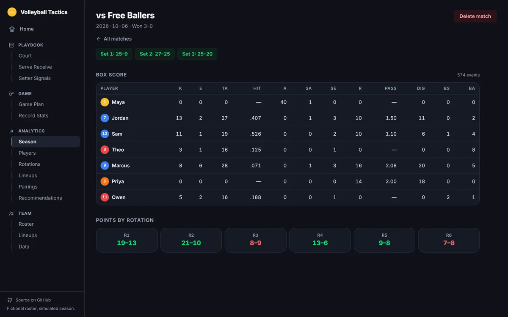
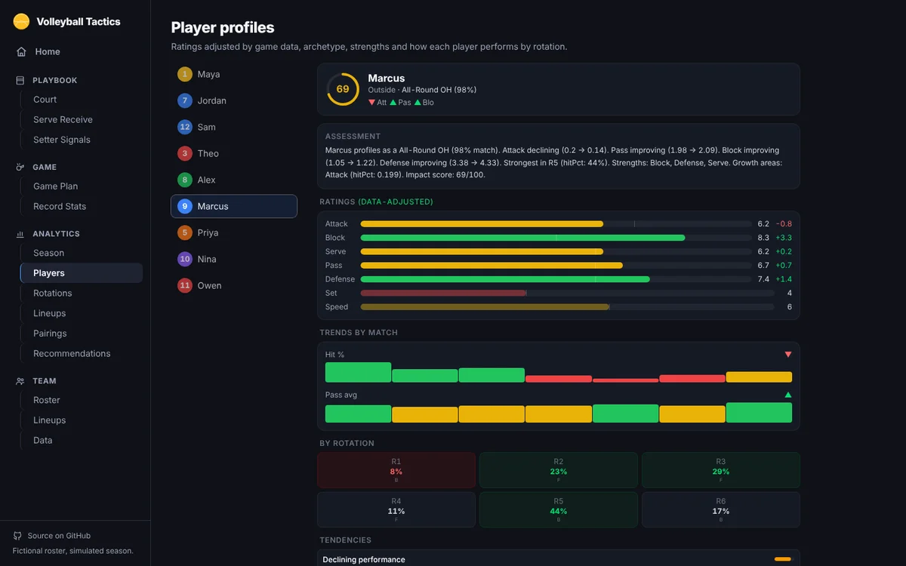
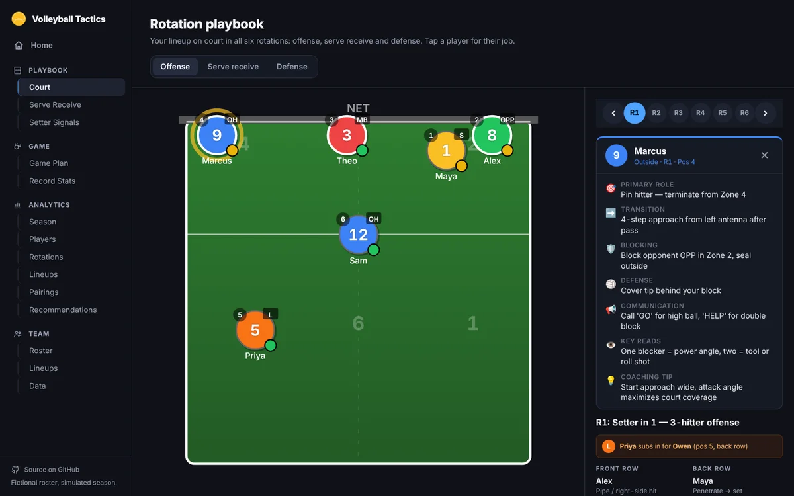
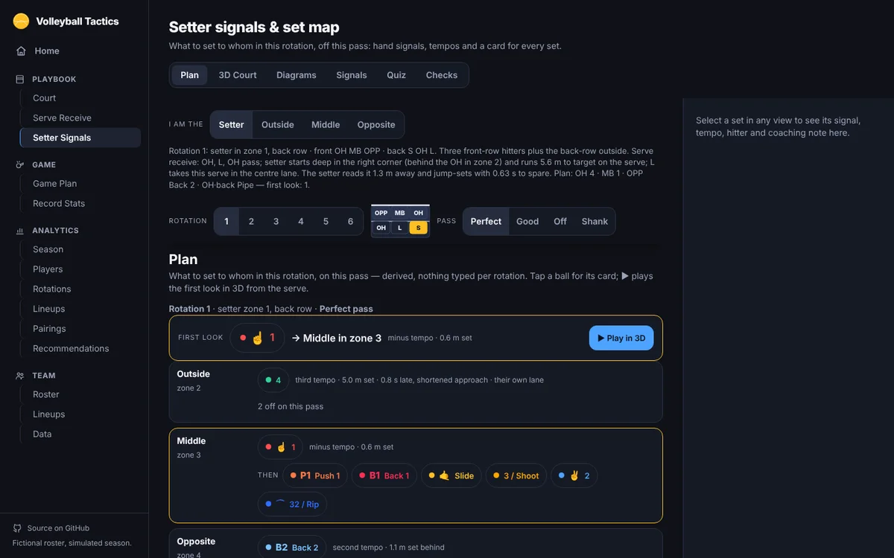
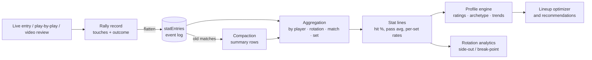

# Volleyball Tactics

[](https://github.com/rodelBeronilla/volleyball-tactics/actions/workflows/deploy.yml)

A coaching tool for a 6v6 volleyball team: an interactive rotation playbook, rally-by-rally stat
capture, and an analytics layer that turns the event log into player ratings, rotation reports and
lineup recommendations.

**Live site:** https://rodelberonilla.github.io/volleyball-tactics/ (opens on a demo season, so
every screen has data)

| Home | Season |
| --- | --- |
|  |  |
| **Box score** | **Player profile** |
|  |  |
| **Rotation playbook** | **Setter signals** |
|  |  |

> The roster is fictional and the match history is simulated. See [Demo data](#demo-data).

## How it's organised

One app, five sections. On desktop they're a sidebar; on a phone, a bottom bar with each section's
pages as tabs. Every page has its own URL (`#/analytics/players/p6`), so links and the back button
work.

| Section | Pages | What's there |
| --- | --- | --- |
| **Home** | | Season at a glance and a way into everything else. |
| **Playbook** | Court · Serve Receive · Setter Signals | The lineup on court in all six rotations (offense, serve receive, defense, tap a player for their job); serve-receive spots checked against the overlap rule; the setter's signal and set map with a 3D set flight view. |
| **Game** | Game Plan · Record Stats | Plan a night of matches (lineup, serving order, substitution system per set, a fairness check that nobody sits two sets in a row), then capture stats live, rally by rally, or from video. |
| **Analytics** | Season · Players · Rotations · Lineups · Pairings · Recommendations | Results and box scores, data-adjusted player profiles, side-out and break-point rates by rotation, lineup composition and optimizer, setter–hitter and row combinations, and suggested changes. |
| **Team** | Roster · Lineups · Data | Players and lineups, plus export, import, compaction and reset of the stored data. |

Serve Receive and Setter Signals are self-contained pages
([`public/tools/`](public/tools)) with their own physics models and self-checks. The app runs them
in a same-origin iframe with their own navigation hidden; the app's tabs drive them, and they report
tab changes back so the URL stays in sync. Opened as a local file, they still work on their own,
offline.

## Data flow

Everything the analytics layer shows comes from one flat event log, so a stat recorded live,
from video, or from the simulator goes through the same aggregation.



### Data model

| Entity | Key fields | Notes |
| --- | --- | --- |
| `player` | `id`, `name`, `number`, `position`, optional `baseRatings` / `archetype` | Ratings are 1–10 per attribute (attack, block, serve, pass, defense, set, speed). |
| `lineup` | `id`, `system` (5-1 / 4-2), `slots{1..6 → playerId}`, `liberoId` | Rotations 1–6 are derived from the slots, never stored. |
| `match` | `id`, `opponent`, `date`, `lineupId`, `sets[{number, ourScore, theirScore, won}]` | |
| `rally` | `id`, `matchId`, `setNumber`, `rallyNumber`, `rotation`, `servingTeam`, `ourScore`, `theirScore` (before the rally), `outcome`, `actions[{playerId, stat, order}]` | Source record for a rally. |
| `statEntry` | `id`, `matchId`, `setNumber`, `rallyId`, `playerId`, `rotation`, `stat`, `timestamp` | One row per touch, plus one team row (`playerId: '__team__'`, `rallyWon` / `rallyLost`) per rally. |
| summary `statEntry` | `type: 'summary'`, `matchId`, `playerId`, `rotation`, `setNumbers`, `counts{stat → n}` | Written by compaction; the aggregators read both shapes. |

Stat definitions (kills, errors, pass grades 0–3, blocks, digs and so on) live in
[`src/data/statCategories.js`](src/data/statCategories.js). Hitting percentage follows the box-score
definition: (kills − errors − blocked) / total attempts.

### How the numbers are built

- **Aggregation** ([`statAggregation.js`](src/utils/statAggregation.js)): counts events by player or
  rotation with optional match / set / rotation filters, then derives stat lines.
- **Ratings** ([`playerProfileEngine.js`](src/utils/playerProfileEngine.js)): each attribute starts
  from a baseline (a coach's rating, an archetype, or a position default). It then moves toward the
  rating implied by the stats as attempts accumulate: confidence is attempts divided by a threshold
  (e.g. 30 passes), so a handful of touches can't swing a rating.
- **Archetypes** ([`archetypes.js`](src/data/archetypes.js)): players are matched to 28 role
  archetypes by cosine similarity of their rating vectors.
- **Lineup optimizer** ([`lineupOptimizer.js`](src/utils/lineupOptimizer.js)): enumerates every
  legal 5-1 slot assignment and scores each one.
- **Compaction** ([`storageManager.js`](src/utils/storageManager.js)): with everything stored in the
  browser, older matches can be rolled up into per-player, per-rotation summary rows. On the demo season that
  means about 13× fewer rows and 4× less storage, with every reported number unchanged.

## Data quality

`npm test` runs [Vitest](https://vitest.dev) suites in [`src/__tests__/`](src/__tests__). Most of
them check invariants that any rally-by-rally feed should satisfy:

- Every event references a known player, match, rally and stat type, and IDs are unique.
- Set scores follow rally-scoring rules, and rally outcomes add up to the recorded final score.
- The running score is continuous from rally to rally.
- Each rally has exactly one team outcome row, and it agrees with the rally.
- Only the player in position 1 serves, and every kill has an assist.
- Compaction preserves per-player totals, per-rotation totals and player ratings.
- Season numbers reconcile: wins + losses = matches played, per-match kills add up to the season.
- The demo game night obeys the league's fairness rule (nobody sits two sets in a row).
- Rotation math, the overlap rule, and stat-line formulas are correct.

Imports are checked for structure before they replace local data, and CI runs lint, tests and a production build
on every push and pull request.

## Demo data

[`src/data/demoSeason.js`](src/data/demoSeason.js) simulates a 7-match season (about 900 rallies and
4,000 events) for the fictional roster. Each player has hidden skill levels, and rallies are played
out touch by touch: serve, pass, set, attack, block and dig. The app then has to recover those skill
levels from the event log, the same way it would for a real team. A planned game night comes with
it. The simulator is seeded, so the demo is identical on every load. **Team → Data → Reset to demo
data** restores it, and **Clear all data** starts from an empty team.

## Tech

React 19 · Vite 8 · Tailwind CSS 4 · Vitest · ESLint 9 · GitHub Actions → GitHub Pages.
Plain JavaScript, no backend: state lives in a single `useReducer` and persists to `localStorage`,
and the whole dataset exports to and imports from JSON.

```
src/
  App.jsx              app shell and route → page mapping
  nav.js, router.js    site map (sidebar, bottom bar, home all read it) and hash router
  hooks/useAppState.js reducer, persistence, derived state (rotations, placements, profiles)
  components/
    shell/             sidebar, bottom bar, page frame, shared UI
    home/ playbook/ game/ analytics/ team/   one folder per section
    court/ stats/ gameday/ lineup/ roster/   building blocks used by the pages
  data/                domain data: formations, responsibilities, stat categories, demo season
  utils/               aggregation, season summary, ratings, profile engine, optimizer, overlap rules
  __tests__/           Vitest suites
public/
  tools/setter-signals/  standalone set-map page (embedded at #/playbook/setter-signals)
  tools/serve-receive/   standalone serve-receive page (embedded at #/playbook/serve-receive)
  setter-signals/, serve-receive/, app/   redirects from the old URLs
```

## Running locally

```bash
npm ci
npm run dev       # http://localhost:5173/volleyball-tactics/
npm test          # unit + data-quality tests
npm run lint
npm run build     # production build in dist/
```

## Next steps

- Port Setter Signals and Serve Receive into React components so they share the app's lineup
  instead of their own role codes.
- Move storage from the browser to a shared database (e.g. Postgres or DuckDB) so a whole staff
  works from the same data, with the event log as the fact table.
- Export the event log as Parquet/CSV for notebooks and BI tools.
- Ingest third-party play-by-play feeds through the same rally → event pipeline, using the
  invariants above as validation checks.
