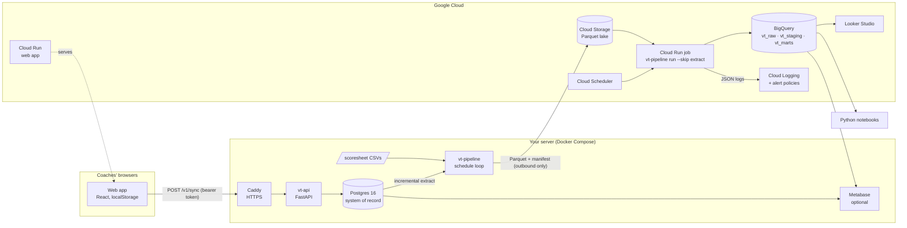

# Architecture

## The problem

The app records rally-by-rally data on a phone or laptop and keeps it in that browser.
That is fine for one coach and useless for a staff: nobody else can query it, a lost
phone is a lost season, and every analysis is re-implemented in the UI.

The platform gives the data a home that several people and tools share, without
moving the app off the free static hosting it already has, and without making the
coach's server a single point of failure for analytics.

## Hybrid topology

**What runs where, and why**

| Concern | Placement | Reason |
| --- | --- | --- |
| Operational writes (sync from the app) | Server | Low volume, needs a database with constraints and history, no cloud cost, data stays at home. |
| Extraction | Server | Next to Postgres; the server only needs **outbound** access to Cloud Storage. No inbound firewall rules, no VPN. |
| Lake | Cloud Storage | Cheap, durable, the hand-off point between the two halves. Every batch is immutable and self-describing (manifest). |
| Warehouse, marts | BigQuery | Scales past anything a rec league produces; Looker Studio and notebooks connect natively; partitioned and clustered tables keep scans small. |
| Load / transform / check | Cloud Run job (or the server) | The same image and the same command run in either place. The cloud job is the default so the warehouse is rebuilt even when the server is off. |
| Web app | Cloud Run (and GitHub Pages) | Static files; Cloud Run gives a proper domain, HTTPS and a place to bake in the API URL. |
| Dashboards | Looker Studio; Metabase on the server as an option | Looker Studio is free and lives next to BigQuery. Metabase covers staff who want dashboards without a Google account. |
| Alerts | Cloud Monitoring (log-based) + webhook | Pipeline logs are structured JSON; two log-based metrics drive alert policies. The webhook reaches Slack, n8n or Discord on the server. |

The local target (DuckDB) is not a toy: `PIPELINE_TARGET=local` is a complete deployment
on one machine, and it is what CI runs end to end.

## Data flow

1. **Capture.** A coach records rallies in the app. Every rally becomes a rally row plus
   flat events (one per touch, plus one team row per rally).
2. **Sync.** With *Team → Data → Shared database* configured, the app pushes its whole
   dataset a few seconds after each change (`POST /v1/sync`). The API normalises the
   payload into relational rows, validates references and vocabularies, upserts what
   changed (content hashes), soft-deletes what the client removed, and records the batch
   and every rejected row.
3. **Extract.** On the server, the pipeline reads rows with `updated_at` in
   `(watermark, cutoff]` inside one REPEATABLE READ snapshot, writes one Parquet file per
   table, then a manifest. Scoresheet CSVs (the third-party source) ride along when
   they change.
4. **Load.** Every manifest not yet in `raw.etl_batches` is appended to the raw tables.
   Idempotent: re-running loads nothing twice.
5. **Transform.** Staging models pick the current version of every row; marts build
   facts, dimensions and aggregates with the app's own metric definitions.
6. **Check.** Thirteen SQL checks run against staging and marts; results land in
   `marts.dq_check_results`, failures are logged as `quality_check_failed` and alerted.
7. **Reconcile.** Source counts captured at extraction are compared with the warehouse;
   official scoresheets are compared with the app's results and box scores.
8. **Serve.** Looker Studio, Metabase and notebooks read `vt_marts`.

## Design decisions

The reasoning is recorded as ADRs in [`docs/adr/`](../adr):

- [0001 Hybrid topology: system of record at home, analytics in the cloud](../adr/0001-hybrid-topology.md)
- [0002 One set of SQL, two engines (BigQuery and DuckDB)](../adr/0002-one-sql-two-engines.md)
- [0003 Snapshot sync with content hashes and soft deletes](../adr/0003-snapshot-sync-and-soft-deletes.md)

## Security posture

- The API needs a bearer token (`SYNC_TOKEN`); without one configured it refuses syncs (503).
- CORS is an explicit allow-list of browser origins.
- Payloads are size-limited; rows are validated before they touch the database; nothing is executed from the payload.
- The server only makes outbound calls to Google APIs with a least-privilege service account (object user on one bucket, data editor on three datasets).
- GitHub Actions deploy through Workload Identity Federation, so no cloud keys live in GitHub.
- Cloud Storage has public access prevention enforced; the Cloud Run web service is the only public endpoint in the project.
